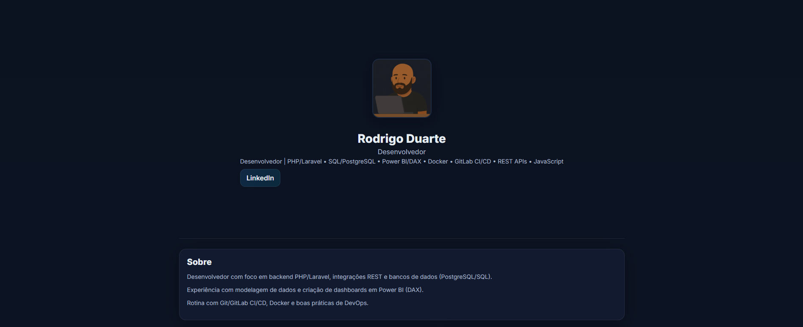

# Portfólio — Rodrigo Duarte

[](#)  
[](#)
[](#)

Site estático com meu portfólio profissional: perfil, experiência, skills, projetos e certificados.

🔗 **Live (GitHub Pages):** https://rodrigoDSouza.github.io/Portfolio/  
💼 **LinkedIn:** https://www.linkedin.com/in/rodrigo-duarte-souza/

---

## 👀 Preview


---

## 🧩 Tecnologias
- **HTML5** + **CSS3**
- **JavaScript** (fetch)
- **JSON** para conteúdo dinâmico

---

## 📂 Estrutura
Portfolio/
├─ index.html # página principal
├─ styles.css # estilos
├─ script.js # renderização dinâmica via data.json
├─ data.json # conteúdo: perfil, projetos, certificados
└─ assets/
└─ avatar.png # avatar exibido no header


---

## ▶️ Rodando localmente
Use qualquer servidor estático. Exemplos:

### VS Code (Live Server)
1. Instale a extensão **Live Server**  
2. Clique com o direito no `index.html` → **Open with Live Server**

### Python (built-in)
```bash
# Python 3
python3 -m http.server 5500
# abra http://localhost:5500

---
🌍 Publicação (GitHub Pages)

No GitHub: Settings → Pages

Source: Deploy from a branch

Branch: main • Folder: / (root)

Salvar e aguardar a publicação.

URL: https://rodrigoDSouza.github.io/Portfolio/

---
🛠️ Personalização rápida
Headline / Sobre / Projetos / Certificados

Edite o data.json. Exemplo para adicionar um projeto:
{
  "name": "Catálogo BI — ICMBio (app_docs)",
  "description": "Site estático para catalogar dashboards e consultas SQL.",
  "tags": ["HTML","CSS","JavaScript","JSON"],
  "link": "https://github.com/SEUUSUARIO/repositorio"
}

---
Avatar

Substitua assets/avatar.png por outra imagem com o mesmo nome.

git add .
git commit -m "docs: atualiza README com link do Pages e instruções"
git push

---
📬 Contato

LinkedIn: https://www.linkedin.com/in/rodrigo-duarte-souza/

---
📝 Licença

Uso pessoal. Sinta-se à vontade para adaptar o modelo.
